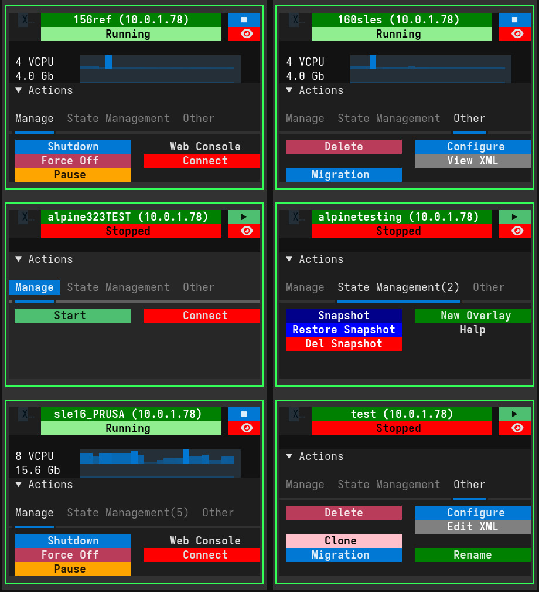
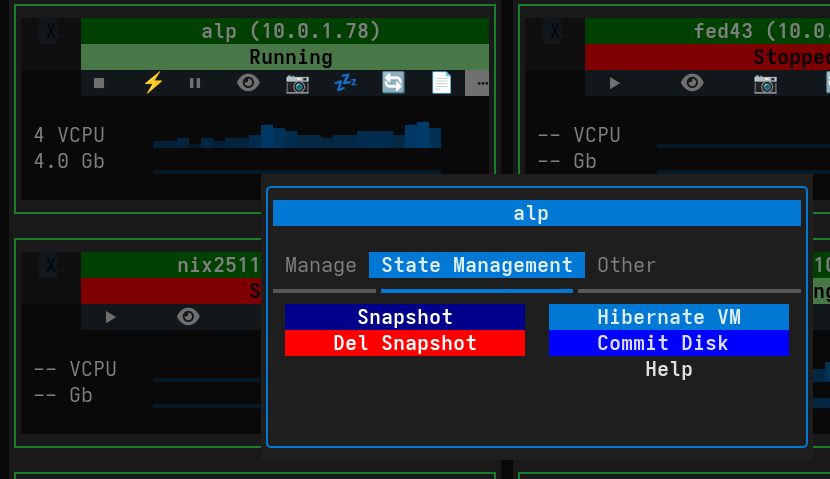
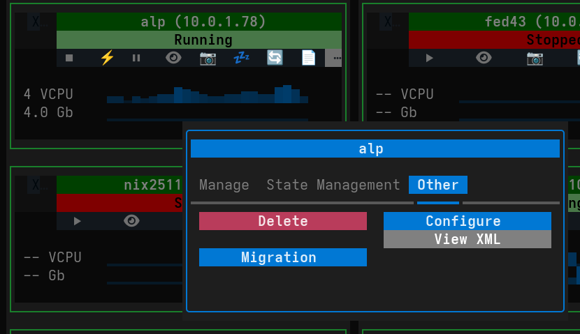

# VM Actions

The Actions panel is the control center for each Virtual Machine. It is opened by clicking the **Actions** button (⋯) on the VM card's quick action bar.

The available operations are organized into three tabs: **Manage**, **State management**, and **Other**.

## Quick Actions Buttons

For faster access to the most common VM operations, quick action buttons are displayed prominently on each VM card's quick action bar. These buttons provide one-click access to essential VM management functions without opening the Actions modal.

The quick action buttons are shown as icons (emoji, with ASCII fallbacks) and dynamically change based on the current VM state:

*   **Start (▶):** Appears when the VM is stopped. Single click to immediately start the VM.
*   **Shutdown (⏻):** Appears when the VM is running or blocked. Sends a graceful ACPI shutdown signal to the guest OS.
*   **Force Off (⚡):** Appears when the VM is running, paused, suspended, or blocked. Immediately cuts power (hard shutdown).
*   **Pause (⏸):** Appears when the VM is running. Freezes VM execution.
*   **Resume (⏯):** Appears when the VM is paused or suspended. Restores the VM from its frozen state.
*   **Connect (👁):** Appears when a desktop remote viewer is available. Launches the configured viewer (e.g., `virt-viewer`) for the VM's display. Equivalent to the "Connect" action in the Manage tab.
*   **Snapshot (📷):** Always available (except while loading). Creates a new snapshot.
*   **Hibernate (💤):** Appears when the VM is running or blocked. Saves the VM state to disk and stops it.
*   **Migration (🔄):** Always available (except while loading). Moves the VM to another server.
*   **XML (📄):** Always available (except while loading). Views or edits the raw libvirt XML.
*   **Actions (⋯):** Always available. Opens the full Actions modal described in the next sections.

These quick action buttons eliminate the need to open the Actions modal for routine power management tasks, making VM operations more efficient and user-friendly.

## Manage Tab

This tab contains the most common power management and connectivity controls.

*   **Start:**
    *   Boots the virtual machine.
    *   *Visible when the VM is Stopped.*

*   **Shutdown:**
    *   Sends an ACPI shutdown signal to the guest operating system, requesting a graceful shutdown.
    *   *Visible when the VM is Running or Blocked.*

  *   **Force Off:**
     *   Forcefully terminates the VM process. This is equivalent to pulling the power plug and may cause data loss.
     *   *Visible when the VM is Running, Paused, Suspended, or Blocked.*

*   **Pause:**
    *   Pauses the execution of the VM, freezing its state in memory.
    *   *Visible when the VM is Running.*

  *   **Resume:**
     *   Resumes execution of a paused VM.
     *   *Visible when the VM is Paused or Suspended.*

*   **Web Console / Show Console:**
     *   **Web Console:** Configures and starts a secure noVNC session, allowing you to access the VM's display via a web browser. Useful for remote access without a dedicated client. *Note: Web Console only works with VNC graphics (not SPICE).*
     *   **Show Console:** appears when a session is active; clicking it opens the browser or reconnects.
     *   **Status Indicator:** Shows a web console icon (🌐, or `[W]` in ASCII mode) next to the VM status when a web console session is active.

*   **Text Console:**
    *   Opens a direct serial console (`virsh console`) to the VM in a new **tmux** window.
    *   *Visible only when VirtUI Manager is running inside a tmux session.*

*   **Connect:**
    *   Launches the configured desktop remote viewer (e.g., `virt-viewer`) for a high-performance native connection to the VM's display (SPICE/VNC).

## VM Card Interactive Features

### Sparkline View Toggle

The VM card displays real-time performance data using sparklines. You can toggle between two different views:

*   **Resource View:** Shows CPU usage and Memory usage sparklines, each labeled with the current percentage (e.g., `CPU 42%`, `Mem 63%`). When the VM is not running, the labels show `CPU --%` / `Mem --%` and the sparklines are empty.
*   **I/O View:** Shows Disk I/O (read/write) and Network I/O (receive/transmit) sparklines, each labeled with the current rate in MB/s (e.g., `Disk R/W 1.25/0.75 MB/s`, `Net Rx/Tx 0.10/2.30 MB/s`). When the VM is not running, the labels show `Disk --` / `Net --`.

**To toggle views:** Click on any sparkline area to switch between Resource and I/O views. The toggle is only available while the VM is running or paused.

### Detailed Tooltip Information

Hover over the VM name for detailed information:

*   UUID and hypervisor connection details
*   Current status and IP addresses
*   Boot device configuration
*   CPU model and memory allocation
*   Server connection information

### Double-Click Refresh

**Double-click** on the VM name to trigger a background refresh of the VM's detailed information, including XML configuration data.

## State management Tab

This tab provides advanced storage management features for version control and testing, as well as VM state persistence.

### Hibernate VM
Saving a VM (also known as "Managed Save") stops the VM and writes its entire memory state to a file on disk. It acts like hibernation on a physical computer.

*   **Hibernate VM:**
    *   Hibernates the virtual machine.
    *   *Visible when the VM is Running or Blocked.*

### Snapshots
Snapshots save the state of the virtual machine (disk and memory) at a specific point in time.

*   **Snapshot:**
    *   Creates a new snapshot. You can provide a name and description.
    *   *Visible in all VM states (except while loading).*

 *   **Restore Snapshot:**
     *   Reverts the VM to a selected snapshot state.
     *   *Visible when the VM is not running or blocked (i.e., stopped, paused, or suspended) and has snapshots.*

*   **Del Snapshot:**
    *   Permanently deletes a selected snapshot.

### Guest Agent

*   **Guest Agent:**
    *   Opens the guest agent modal, which shows the agent's status (hostname, OS, kernel, uptime, load), a filesystem usage table, and lets you run guest operations: freeze/thaw filesystem, trim, sync time, set user password, guest shutdown, suspend to RAM/disk, run a command, manage SSH keys, and upload/download files.
    *   *Visible when the VM is Running or Paused.*

### Overlays
Overlays (or "Linked Clones" for a single disk) allow you to create a temporary writable layer on top of your base disk image. This is ideal for testing potentially destructive changes.

*   **New Overlay:**
    *   Creates a new overlay file backed by the current disk image. Changes are written to the overlay, leaving the original disk untouched.
    *   *Visible when the VM is Stopped and no overlay exists.*

*   **Commit Disk:**
    *   Merges changes from the active overlay back into the base backing file.
    *   *Visible when the VM is Running or Blocked and using an overlay.*

*   **Discard Overlay:**
    *   Deletes the overlay file, discarding all changes made since it was created, and reverts the VM to the base image.
    *   *Visible when the VM is Stopped and using an overlay.*

*   **Help:**
    *   Displays a guide on how to use the Overlay feature.

## Other Tab

This tab contains administrative actions for the VM lifecycle.

 *   **Delete:**
     *   Permanently deletes the virtual machine. You will be prompted to choose whether to delete the associated storage (disk images) or keep them.
     *   *Visible in all VM states.*

*   **Clone:**
     *   Creates a duplicate of the VM. Opens an advanced dialog where you can configure:

         1.  **Base Name:** The name for the new VM(s). Spaces are automatically sanitized to hyphens.
         2.  **Suffix (optional):** A suffix appended to each clone's name, allowing multiple clones from a single operation (e.g., `clone-vm_1`, `clone-vm_2`). Required when creating more than one clone.
         3.  **Number of Clones:** How many copies to create at once.
         4.  **Do Not Clone Storage (Linked Clone):** When *unchecked* (default), a full deep copy of the disk images is created — the new VMs are fully independent but use more storage and take longer. When *checked*, only the VM definition is cloned while sharing the original disk image (a linked clone) — fast and space-efficient, but changes to the base disk will affect all clones.
         5.  **NVRAM Clone:** The NVRAM file (for UEFI variables) is always cloned alongside the full storage copy for proper VM independence.

     *   If cloning fails for some VMs in a batch operation, you'll see which succeeded and which failed.
     *   *Visible when the VM is Stopped.*

*   **Migration:**
    *   Moves the VM to another server managed by VirtUI Manager.
    *   Requires SSH connectivity between hosts.

*   **Configure:**
    *   Opens a detailed view of the VM's hardware configuration (CPU, Memory, Disks, Networks, etc.).

*   **View XML / Edit XML:**
     *   A single toggle button that displays "Edit XML" when the VM is Stopped (opens an editor to manually modify the VM's XML configuration) and "View XML" when the VM is Running (displays the raw Libvirt XML configuration for inspection).

*   **Rename:**
    *   Changes the name of the virtual machine.
    *   *Visible when the VM is Stopped.*
